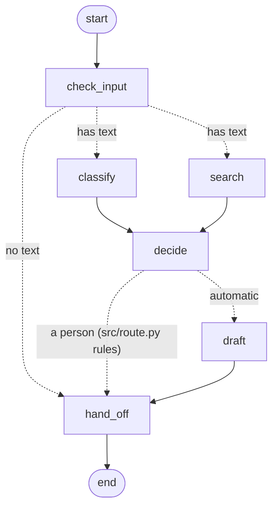

# Design

Each ticket goes through six steps:

1. Read: put the ticket in one standard shape.
2. Classify: decide what the ticket is about and how urgent it is.
3. Search: find the help-article passages that match.
4. Decide: answer automatically, or send to a person.
5. Answer: write a reply using only those passages, and show the sources.
6. Check: block the reply if it is unsafe or not supported by the sources.

Every decision is recorded with its reason. If any step fails, the ticket goes to a person.
More detail is added here as each step is built (see the Stage 3 specifications, FR-01 to FR-12).

## How the steps are joined: LangGraph

The Project Brief names "LangChain with LangGraph" for orchestration. The flow is a LangGraph
graph in `src/graph.py`; `pipeline.process()` runs one ticket through it, and the harness
calls `process()` for every ticket.

- Classify and search do not depend on each other, so they run side by side; decide waits for both.
- Decide applies the routing rules in `src/route.py` (B-07): could not classify, a
  never-automate topic (FR-05), confidence below the threshold, or no matching passage ->
  a person; otherwise -> automatic.
- Draft is a placeholder until B-08: it records that the ticket would have been answered and
  passes it to hand_off. B-08 and B-09 replace it with draft -> safety checks -> reply, with a
  route back to hand_off whenever a check fails.
- `python -m src.graph` prints the current graph as a Mermaid diagram.

## What LangChain does, and what is our own code

| Step | LangChain / LangGraph part | Our own code | Why our own code |
|---|---|---|---|
| Joining the steps | LangGraph `StateGraph` | the nodes in `src/graph.py` | – |
| Read & clean (B-02) | – | `src/ingest.py` | Plain data cleaning; nothing in LangChain does it |
| Splitting articles (B-03) | – | `split_by_section` in `src/retrieve.py` | Splitting by the article's own sections won the measured comparison |
| Search (B-04) | `langchain-chroma` (`Chroma`), `HuggingFaceEmbeddings` | minimum score, passage ids for citations | – |
| Model call (B-06 and later) | `ChatOpenAI` (OpenRouter), `ChatPromptTemplate`, messages | answer cache, waiting and retrying, counting calls | So runs are repeatable, stay inside rate limits, and the metrics can report the number of calls |
| Classify (B-06) | – | trained classifier, agreement cases, measured confidence | Our own measured design (Stage 5, change 2); LangChain has no part for it |
| Decide (B-07) | the conditional edge out of decide | the rules in `src/route.py` | Must be plain code so the same ticket always gets the same decision (FR-04) |

Prompts stay as versioned files in `prompts/`. `src/llm.py` turns each file into a LangChain
`ChatPromptTemplate`. The text sent is exactly the same as before the move, so saved answers
in the cache still match.

## Search settings

Chroma's search is approximate (HNSW). Its default setting checks too few candidates when we
ask for 10 passages, and could miss close ones. `INDEX_SETTINGS` in `src/retrieve.py` raises it
so the result matches checking every passage (tested in `tests/test_retrieve.py`).
